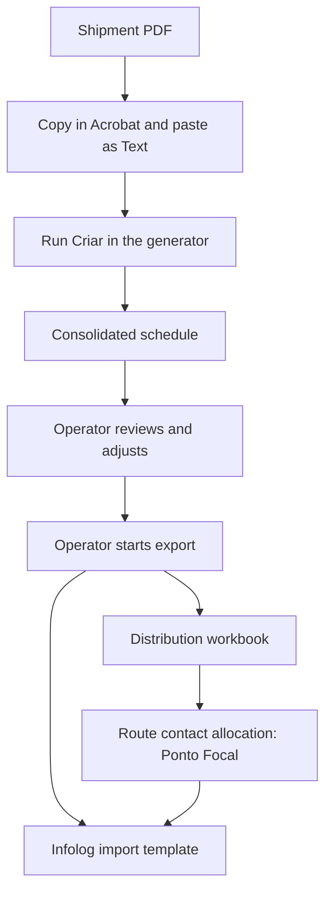

# Logistics Scheduling with Excel and VBA

[Português (Brasil)](README.pt-BR.md)

An Excel/VBA tool developed for a Brazilian logistics operation. It turns text copied from a shipment PDF into a consolidated delivery schedule, supports an operator's review, and exports the approved data to distribution workbooks and an Infolog import template.

I started this project by writing the VBA myself and refined it through operational use and testing. AI tools later supported some iterations, while I continued to review the logic, understand the changes and validate the results.

This portfolio package demonstrates the **standard FT workflow** using fictional store codes. The application remains in Portuguese; this README provides an English guide to the problem, implementation and demonstration.

## The operational problem

The workflow starts with an existing shipment report rather than a structured data feed. Its text layout, separators and regional formats matter to the VBA parser. The project automates the preparation and transfer of scheduling data between the formats used by the operation.

The consolidated workbook is an intermediate working document. **An operator must check and, where necessary, adjust the schedule before deciding to export.** The macros perform checks, but operational approval remains a human task.

## Workflow

The Infolog output is an Excel template. This demonstration does not submit data to a live Infolog system.

## What the project demonstrates

- Parsing a specific operational report format and applying logistics rules in VBA.
- Working across multiple Excel workbooks, reference tables and UserForms.
- Preparing schedules for review, including delivery times, quantities and route information.
- Exporting distribution data and filling a transport-system template.
- Allocating route contacts and maintaining an index of processed routes.
- Packaging an existing application with relative paths and a repeatable initial state.

The portfolio adaptation preserves the validated business rules. It is not a rewrite of the original application.

## Language and sample data

The code, comments, interface, worksheet names and source report remain in Brazilian Portuguese. They reflect the operation in which the project was developed. Keeping these identifiers avoids unnecessary changes to a validated application; the documentation explains the workflow in English.

The PDF uses fictional store codes **Z00–Z77** and the user identifier **DEMOUSER**. Other report fields and branding have been retained to preserve the input format. The entire report should therefore not be described as synthetic data.

Dates follow the Brazilian convention: `01.10.26` in the filenames means **1 October 2026**. The input also uses Brazilian number formats. The demonstration was validated in a Portuguese-language Excel environment on Windows; other regional configurations have not been validated.

## Requirements

- Microsoft Excel desktop for Windows, with VBA macros enabled for this project.
- Adobe Acrobat Reader for the validated copy-and-paste method.
- A locally extracted copy of the package, with the `app/` structure and filenames preserved.

The VBA runs in desktop Excel. GitHub is used to present and distribute the project, not to execute it. A replacement PDF extraction method is outside this demonstration's scope.

## Run the demonstration

1. Download or clone the repository and extract it to a local folder.
2. Open the [fictional FT PDF](<app/arquivos_criacao_prog/Preliminar FT normal - Portfolio ficticio.pdf>) in Adobe Acrobat Reader. Select all text and copy it with **Ctrl+A**, then **Ctrl+C**.
3. Open [the generator](app/criacao_prog_v5_6_testes.xlsm). In `Planilha1`, select the green cell **A2** and use **Paste Special → Text** (`Ctrl+Alt+V`; select `Texto`). Preserve the report's separators, including the dots in the header.
4. Click **Criar** (Create) to generate the consolidated workbook in `app/`.
5. Review the consolidated schedule. Check the operational details and make any necessary adjustments.
6. Click **EXPORTAR**, select **Tbl_Distribuição + Template Infolog**, and confirm the export when the schedule is ready.

The combined export creates or updates:

| Output | Location relative to `app/` |
| --- | --- |
| Distribution workbook | `Tbl_Prog_Testes/` |
| Infolog template | `Templates/` |
| Route contact workbook | `Tbl_PontoFocal/<year>/Sem<week>/` |
| Processed-route index | `Tbl_PontoFocal_Index.xlsx` |

The package starts with empty output folders and an index with no processed records. To repeat a demonstration from the same initial state, use a fresh extracted copy. This package does not include an automatic reset tool.

Generated working files retain the application's expiry and archive rules. Reopening the generator may archive older outputs. Keep the static examples separate and generate a new working base when running the demonstration.

## Validated examples

The [official reference outputs](examples/expected-output/) contain:

| Measure | Reference run |
| --- | ---: |
| Stores | 78 |
| Routes | 32 |
| Boxes | 14,770 |
| Store/CD records in the distribution and Infolog workbooks | 109 each |
| Route contact records | 32 |

These are reviewed outputs from one run. They include operational adjustments and are not a promise that every intermediate value will match a newly generated workbook before review.

A separate test started from an operator-adjusted base with AM routes removed: **72 stores, 31 routes and 14,714 boxes**. The combined export was checked against that base, including the scheduling times and route-contact assignments. It does not replace the official reference set above.

The reference consolidated workbook has its opening expiry routine disabled so that it can be consulted later. Its operational buttons have not been adapted to run from the examples folder; use the generator in `app/` to execute the workflow.

## Repository guide

| Folder | Purpose |
| --- | --- |
| `app/` | Executable workbooks, models, fictional input, reference data and assets |
| `examples/expected-output/` | Reviewed reference outputs |
| `src/vba/` | Extracted VBA source for reading on GitHub |
| `docs/` | Package map, validation notes and content review |

Start reading the code with the [VBA guide](src/vba/LEIA-ME.md). The main entry points are the generator's [Create button routine](<src/vba/gerador/Módulo2.bas>), the consolidated workbook's [export routines](<src/vba/consolidado/Módulo1.bas>) and the [Infolog routines](<src/vba/consolidado/Módulo2.bas>).

The source export contains **81 module, class and form-code files**. The `.frm` files contain event code only, without the visual form descriptor or `.frx` resources required for reconstruction by import. The complete forms remain in the XLSM files.

## Scope and validation limits

- The demonstrated case is standard FT. Other models remain as support files, but their workflows are outside the validated demonstration.
- Manual refresh of the route-contact cache and external pallet-planning sources are not included. The demonstrated workflow uses the cache supplied in the generator.
- Legacy shared-workbook mode was removed from the distribution export in this portfolio copy. Internal opening of the route-contact engine skips its startup maintenance; normal generator opening retains its maintenance rules.
- The publication copy was cleaned of the internal tutorial link, personal save-location metadata and the reference distribution's revision history. The PDF's page content and extracted text were preserved, and all 15 rendered pages matched before and after metadata removal.
- After that cleanup, the 12 remaining Excel files were opened in read-only mode. The complete business workflow was not rerun at that stage.

The detailed [content review](docs/REVISAO_CONTEUDO_PUBLICO.md) and [export validation record](docs/VALIDACAO_EXPORTACAO.md) are currently in Portuguese.
