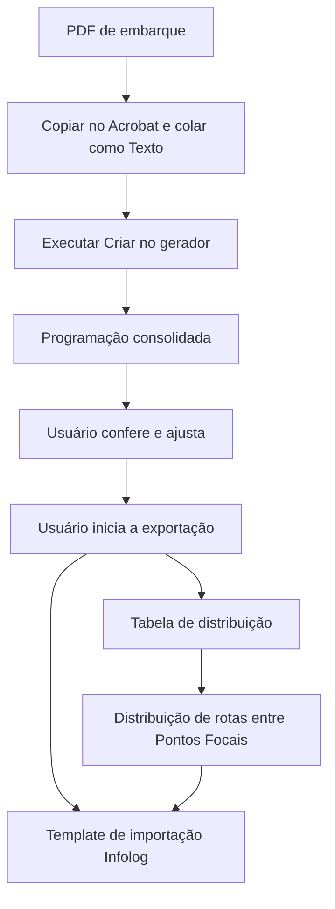

# Programação Logística com Excel e VBA

[English (UK)](README.md)

Ferramenta em Excel/VBA desenvolvida para uma operação logística brasileira. Ela transforma o texto copiado de um PDF de embarque em uma programação consolidada, permite a conferência pelo usuário e exporta os dados aprovados para tabelas de distribuição e um template de importação do Infolog.

Comecei o projeto escrevendo o VBA por conta própria e fui aperfeiçoando a ferramenta com o uso e os testes na operação. Depois, a IA apoiou algumas iterações, enquanto continuei revisando a lógica, entendendo as alterações e validando os resultados.

Este pacote de portfólio demonstra o fluxo **FT normal**, com códigos fictícios de lojas. A aplicação permanece em português; o README em inglês apresenta o problema, a implementação e a demonstração para outros públicos.

## O problema da operação

O fluxo começa com um relatório de embarque existente, e não com uma fonte de dados estruturada. O layout do texto, os separadores e os formatos regionais são importantes para a interpretação feita pelo VBA. O projeto automatiza a preparação e a transferência dos dados entre os formatos usados pela operação.

O consolidado é um arquivo intermediário de trabalho. **O usuário precisa conferir e, quando necessário, ajustar a programação antes de decidir pela exportação.** As macros realizam verificações, mas a aprovação operacional continua sendo uma tarefa humana.

## Fluxo

A saída do Infolog é um template Excel. Esta demonstração não envia dados para um ambiente real do sistema.

## O que o projeto demonstra

- Interpretação de um formato específico de relatório e aplicação de regras logísticas em VBA.
- Integração entre arquivos Excel, cadastros e UserForms.
- Preparação de programações para conferência, incluindo horários, quantidades e informações de rota.
- Exportação dos dados de distribuição e preenchimento de um template de sistema de transporte.
- Distribuição de rotas entre Pontos Focais e controle das chaves já processadas.
- Organização de uma aplicação existente com caminhos relativos e um estado inicial reproduzível.

A adaptação para o portfólio preserva as regras de negócio validadas. Não é uma reescrita da aplicação original.

## Idioma e dados do exemplo

Código, comentários, interface, nomes das planilhas e relatório de entrada permanecem em português brasileiro. Eles refletem a operação para a qual o projeto foi desenvolvido. Manter esses identificadores evita alterações desnecessárias em uma aplicação validada; a documentação explica o funcionamento também em inglês.

O PDF usa os códigos fictícios **Z00–Z77** e o identificador de usuário **DEMOUSER**. Outros campos operacionais e as marcas foram mantidos para preservar o formato de entrada. Portanto, o relatório inteiro não deve ser descrito como composto de dados sintéticos.

As datas seguem a convenção brasileira: `01.10.26` nos nomes dos arquivos significa **1º de outubro de 2026**. A entrada também usa formatos numéricos brasileiros. A demonstração foi validada em um ambiente Excel em português no Windows; outras configurações regionais não foram validadas.

## Requisitos

- Microsoft Excel desktop para Windows, com execução de macros VBA habilitada para o projeto.
- Adobe Acrobat Reader para o método de cópia e colagem validado.
- Uma cópia extraída localmente, mantendo a estrutura de `app/` e os nomes dos arquivos.

O VBA é executado no Excel desktop. O GitHub apresenta e distribui o projeto, mas não executa a aplicação. Substituir a extração de texto do PDF está fora do escopo desta demonstração.

## Executar a demonstração

1. Baixe ou clone o repositório e extraia os arquivos em uma pasta local.
2. Abra o [PDF fictício FT](<app/arquivos_criacao_prog/Preliminar FT normal - Portfolio ficticio.pdf>) no Adobe Acrobat Reader. Selecione todo o texto e copie com **Ctrl+A** e **Ctrl+C**.
3. Abra [o gerador](app/criacao_prog_v5_6_testes.xlsm). Na `Planilha1`, selecione a célula verde **A2** e use **Colar Especial → Texto** (`Ctrl+Alt+V`; escolha `Texto`). Preserve os separadores do relatório, incluindo os pontos no cabeçalho.
4. Clique em **Criar** para gerar o consolidado em `app/`.
5. Confira a programação consolidada e faça os ajustes operacionais necessários.
6. Clique em **EXPORTAR**, selecione **Tbl_Distribuição + Template Infolog** e confirme quando a programação estiver pronta.

A exportação combinada cria ou atualiza:

| Saída | Local relativo a `app/` |
| --- | --- |
| Tabela de distribuição | `Tbl_Prog_Testes/` |
| Template Infolog | `Templates/` |
| Tabela de Ponto Focal | `Tbl_PontoFocal/<ano>/Sem<semana>/` |
| Índice de rotas processadas | `Tbl_PontoFocal_Index.xlsx` |

O pacote começa com as pastas de saída vazias e o índice sem registros processados. Para repetir a demonstração a partir do mesmo estado inicial, use uma nova cópia extraída. O pacote não inclui uma ferramenta de reinicialização automática.

Os arquivos de trabalho gerados mantêm as regras de expiração e arquivamento da aplicação. Reabrir o gerador pode arquivar saídas antigas. Mantenha os exemplos estáticos separados e gere uma nova base de trabalho ao executar a demonstração.

## Exemplos validados

As [saídas oficiais de referência](examples/expected-output/) contêm:

| Medida | Execução de referência |
| --- | ---: |
| Lojas | 78 |
| Rotas | 32 |
| Caixas | 14.770 |
| Registros de lojas/CDs na distribuição e no Infolog | 109 em cada arquivo |
| Registros de Ponto Focal | 32 |

São saídas conferidas de uma execução. Elas incluem ajustes operacionais e não significam que todos os valores intermediários de um arquivo recém-gerado terão de coincidir antes da conferência.

Um teste separado partiu de uma base ajustada pelo usuário, com as rotas AM removidas: **72 lojas, 31 rotas e 14.714 caixas**. A exportação combinada foi comparada com essa base, incluindo horários e atribuições de Ponto Focal. Esse teste não substitui o conjunto oficial acima.

O consolidado de referência tem a rotina de expiração da abertura desativada para permitir consulta posterior. Seus botões operacionais não foram adaptados para executar na pasta de exemplos; use o gerador de `app/` para executar o fluxo.

## Organização do repositório

| Pasta | Finalidade |
| --- | --- |
| `app/` | Aplicação, modelos, entrada fictícia, cadastros e imagens |
| `examples/expected-output/` | Resultados conferidos para referência |
| `src/vba/` | Código VBA extraído para leitura no GitHub |
| `docs/` | Mapa do pacote, validações e revisão do conteúdo |

Para ler o código, comece pelo [guia do VBA](src/vba/LEIA-ME.md). Os principais pontos de entrada são a [rotina do botão Criar](<src/vba/gerador/Módulo2.bas>), as [rotinas de exportação](<src/vba/consolidado/Módulo1.bas>) e as [rotinas do Infolog](<src/vba/consolidado/Módulo2.bas>).

A exportação contém **81 arquivos de módulos, classes e código de formulários**. Os `.frm` contêm apenas os eventos, sem o descritor visual e os recursos `.frx` necessários para reconstrução por importação. Os formulários completos permanecem nos XLSM.

## Escopo e limites da validação

- O caso demonstrado é FT normal. Outros modelos permanecem como suporte, mas seus fluxos estão fora da demonstração validada.
- A atualização manual do cache de Ponto Focal e as fontes externas de Monta Palete não estão incluídas. O fluxo demonstrado usa o cache fornecido no gerador.
- O compartilhamento legado foi retirado da exportação da distribuição nesta cópia de portfólio. A abertura interna do engine de Ponto Focal não executa a manutenção de abertura; o uso normal do gerador mantém essas regras.
- A cópia pública passou por limpeza do link interno de tutorial, dos metadados pessoais de gravação e do histórico de revisões da distribuição de referência. O conteúdo e o texto do PDF foram preservados, e as 15 páginas renderizadas ficaram iguais antes e depois da retirada dos metadados.
- Após essa limpeza, os 12 arquivos Excel restantes foram abertos em leitura. O fluxo de negócio completo não foi repetido nessa etapa.

Os detalhes estão na [conferência do conteúdo público](docs/REVISAO_CONTEUDO_PUBLICO.md) e no [registro de validação das exportações](docs/VALIDACAO_EXPORTACAO.md).
